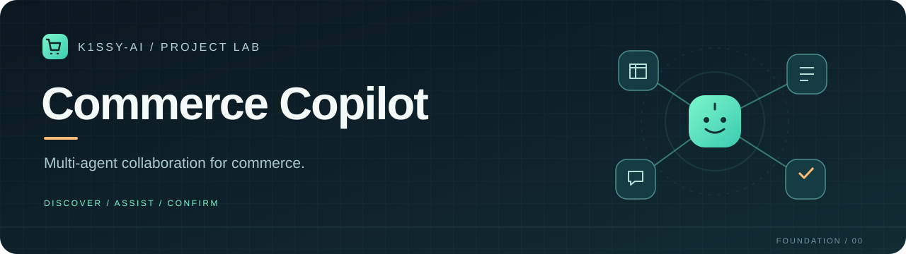
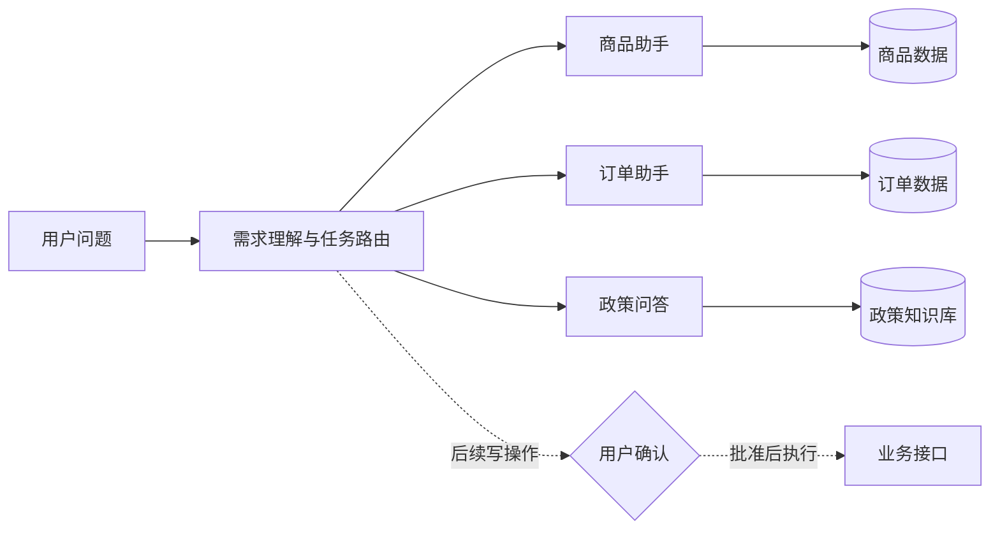

<div align="center">



# Commerce Copilot

### 从多智能体服务编排，走向电商业务协作

一个由 **[K1Ssy-ai](https://github.com/K1Ssy-ai)** 持续维护的电商智能助手项目。


[项目定位](#项目定位) · [能力规划](#能力规划) · [演进路线](docs/ROADMAP.md) · [来源说明](docs/PROVENANCE.md)

[个人项目仓库](https://github.com/K1Ssy-ai/commerce-copilot) · [原项目 Fork](https://github.com/K1Ssy-ai/langgraph_multi-agent-rag-customer-support)

</div>

---

## 项目定位

Commerce Copilot 面向电商导购与客户服务，计划把商品查询、订单查询、售后申请和人工确认连接成可追踪的协作流程。

当前版本是**项目筹备与文档版本**：完成品牌展示、业务边界、架构草案和开发路线；尚未实现电商运行服务，也没有部署在线演示。功能开发将在后续迭代中推进。

学习参考项目为 [liangdabiao/langgraph_multi-agent-rag-customer-support](https://github.com/liangdabiao/langgraph_multi-agent-rag-customer-support)。参考项目的原始代码和历史已保存在 [K1Ssy-ai 的 Fork](https://github.com/K1Ssy-ai/langgraph_multi-agent-rag-customer-support) 中；本仓库当前仅包含新编写的展示与规划材料。源码复用前须确认许可，具体见[来源说明](docs/PROVENANCE.md)。

## 能力规划

| 业务模块 | 预期体验 | 当前状态 |
| --- | --- | --- |
| 商品导购 | 按预算、品类和需求筛选商品，并说明推荐依据 | 规划中 |
| 订单服务 | 查询订单状态、物流与订单详情 | 规划中 |
| 售后助手 | 根据政策解释退换货条件，收集申请材料 | 规划中 |
| 知识问答 | 从商品资料和店铺政策中检索，附上可核验依据 | 规划中 |
| 人工确认 | 修改订单、取消或申请退款前展示操作摘要并等待确认 | 规划中 |
| 项目文档 | 展示定位、架构草案、任务清单与来源边界 | 已完成初稿 |

第一阶段优先验证「商品查询 → 订单只读查询 → 政策问答」；涉及订单变更和退款的流程后置。

## 设计方向



这是目标架构草案，技术选型和接口契约仍待验证。设计原则与上游到电商的场景映射见[架构文档](docs/ARCHITECTURE.md)。

## 演进路线

| 阶段 | 交付物 | 进入下一阶段的条件 |
| --- | --- | --- |
| **00 · Foundation** | 展示材料、来源记录、任务清单 | 完成仓库建立与账号归属验证 |
| **01 · Read-only MVP** | 本地商品与订单查询、离线演示 | 明确实现方式和数据边界后开始开发 |
| **02 · Knowledge** | 政策检索、引用与失败回退 | 以离线样例验证回答依据 |
| **03 · Assisted Actions** | 订单操作提案、确认、恢复与审计 | 重复提交与拒绝操作的测试通过 |
| **04 · Portfolio** | 演示截图、实测结果与部署说明 | 能复现功能且不依赖真实客户数据 |

具体待办和验收标准见[开发路线](docs/ROADMAP.md)。当前停留在 **00** 阶段，已完成[三个典型电商演示场景的需求设计](docs/DEMO_SCENARIOS.md)，涵盖商品筛选、本人订单查询和带来源的政策问答；业务定义见[最小术语表](docs/GLOSSARY.md)。

## 开始阅读

```text
commerce-copilot/
├── README.md                 项目展示与当前进度
├── CHANGELOG.md              实际完成的变更记录
├── CONTRIBUTING.md           开发与提交约定
├── docs/
│   ├── ARCHITECTURE.md       目标架构和业务映射
│   ├── DEMO_SCENARIOS.md     三个演示问题及验收条件
│   ├── GLOSSARY.md           商品、订单与售后术语边界
│   ├── ROADMAP.md            分阶段任务及验收标准
│   ├── PROVENANCE.md         参考来源与授权边界
│   ├── DEVELOPMENT.md        本地工作与验证方法
│   └── assets/banner.svg    原创矢量封面
└── .github/
    └── pull_request_template.md
```

当前无需 API Key、数据库或模型服务。阅读文档即可了解项目；可运行应用的安装说明将在首个可运行版本完成后补充。

## 持续开发

已安排每天北京时间 **20:30** 在当前工作环境中跟进。从当前阶段选择一个可验收的小任务：说明问题、完成改动、执行适当验证，再提交实际结果。任务执行依赖可用的本地环境、账号登录和网络。没有有意义的变更时不创建提交；不修改历史日期，也不以空提交制造活跃记录。

GitHub 贡献图还取决于提交邮箱、仓库类型和分支。本项目计划使用独立仓库与默认分支承载原创开发，参考 Fork 保留上游来源。[GitHub 贡献统计规则](https://docs.github.com/en/account-and-profile/reference/profile-contributions-reference)

## 维护与来源

维护者：**K1Ssy-ai**。本仓库新增展示材料不代表对参考项目原始代码的著作权或再许可声明。完整参考链和本地核对记录见[来源说明](docs/PROVENANCE.md)。
